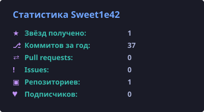
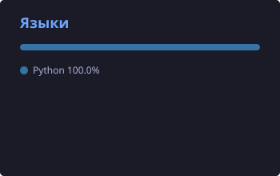
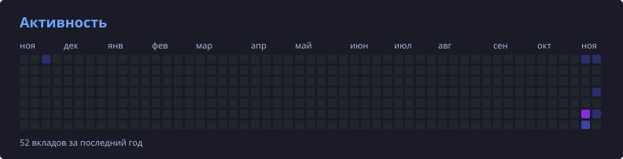

<div align="center">


<p>
  <a href="https://discord.gg/XtyfDvn6Xa"></a>
  <a href="https://www.youtube.com/@sweet1e42"></a>
  <a href="https://github.com/SWAY-gg"></a>
</p>


</div>

---

<h2 align="center">👤 Обо мне</h2>

<table align="center"><tr><td>

```python
class Sweet1e42:
    def __init__(self):
        self.role      = "Python & Discord Bots Developer"
        self.team      = "SWAY"
        self.languages = ["Python", "HTML/CSS", "JavaScript", "C#"]
        self.libraries = ["disnake", "discord.py", "Discord.Net"]
        self.hobbies   = ["Discord-боты", "YouTube-уроки", "тёмные интерфейсы"]

    def say_hi(self):
        return "Делаю инструменты и ботов для комьюнити 💜"
```

</td></tr></table>

<p align="center">
  🤖 Пишу Discord-ботов: от небольших серверных помощников до ботов с собственным сайтом<br/>
  🎓 Учу других: веду на YouTube курс по созданию Discord-ботов с нуля<br/>
  🌐 Делаю веб-сайты для своих ботов и проектов команды <b>SWAY</b><br/>
  🐧 Свои боты держу на Ubuntu Server под управлением <code>uv</code> + <code>pm2</code>
</p>

<h2 align="center">🔭 Сейчас делаю</h2>

<p align="center">
  ✅ Обновил оформление YouTube-канала: баннер, аватар и шаблон превью<br/>
  🎬 Перезаписываю первый урок курса уже на <b>disnake</b><br/>
  ⚔️ Довожу <b>ExileScope</b>: оценка цены предмета и ссылка на Trade<br/>
  🫐 Вывожу <b>BlueBerry</b> из беты<br/>
  🛡️ Добавляю новые функции в <b>RUDI</b>
</p>

---

<h2 align="center">🤖 Мои проекты</h2>

<table align="center">
  <tr>
    <td width="50%" valign="top" align="center">
      <h3>🫐 BlueBerry</h3>
      <p>Многофункциональный Discord-бот с собственным веб-сайтом. Сейчас в бете.</p>
      <a href="https://blueberry-bot.ru"></a>
      
    </td>
    <td width="50%" valign="top" align="center">
      <h3>🌊 WaveShape</h3>
      <p>Рабочий проект команды SWAY: заходи и пробуй.</p>
      <a href="https://waveshape.ru"></a>
      <a href="https://github.com/SWAY-gg/WaveShape"></a>
    </td>
  </tr>
  <tr>
    <td width="50%" valign="top" align="center">
      <h3>⚔️ ExileScope</h3>
      <p>Discord-бот для <b>Path of Exile</b>: сканирует предмет, оценивает его стоимость и даёт ссылку на Trade.</p>
      
      
      
    </td>
    <td width="50%" valign="top" align="center">
      <h3>🛡️ RUDI</h3>
      <p>Приватный Discord-бот, написанный под один конкретный сервер.</p>
      
      
    </td>
  </tr>
</table>

---

<h2 align="center">🎬 YouTube: уроки по Discord-ботам</h2>

<p align="center">
  На канале <b><a href="https://www.youtube.com/@sweet1e42">Sweet1e42</a></b> разбираю создание Discord-ботов на Python с нуля,
  от первого бота до рабочих фич.<br/>
  Исходники к каждому эпизоду лежат в <a href="https://github.com/SWAY-gg/youtube-tutorials/releases">репозитории курса</a>: один релиз = один эпизод.
</p>

<h3 align="center">📺 Последние видео</h3>

<p align="center">
<!-- YOUTUBE:START --><a href="https://www.youtube.com/watch?v=xUQFX3Jana0"></a><a href="https://www.youtube.com/watch?v=oNU59VmXWlo"></a><!-- YOUTUBE:END -->
</p>

<p align="center">
<a href="https://www.youtube.com/@sweet1e42?sub_confirmation=1"></a>
</p>

---

<h2 align="center">🧰 Стек и инструменты</h2>

<div align="center">

<p align="center"><b>Языки и библиотеки</b></p>


<p align="center"><b>Базы данных, сервер и инструменты</b></p>


</div>

---

<h2 align="center">📈 GitHub статистика</h2>

<div align="center">





<h3 align="center">📊 График активности</h3>



<h3 align="center">🐍 Змейка по коммитам</h3>

<picture>
  <source media="(prefers-color-scheme: dark)" srcset="https://raw.githubusercontent.com/Sweet1e42/Sweet1e42/output/github-snake-dark.svg" />
  <source media="(prefers-color-scheme: light)" srcset="https://raw.githubusercontent.com/Sweet1e42/Sweet1e42/output/github-snake.svg" />
  
</picture>

</div>

---

<h2 align="center">📬 Контакты</h2>

<div align="center">

<table align="center">
  <tr><th>Где</th><th>Ссылка</th></tr>
  <tr><td>💬 Discord-сервер</td><td><a href="https://discord.gg/XtyfDvn6Xa">discord.gg/XtyfDvn6Xa</a></td></tr>
  <tr><td>▶️ YouTube</td><td><a href="https://www.youtube.com/@sweet1e42">@sweet1e42</a></td></tr>
  <tr><td>🫐 BlueBerry</td><td><a href="https://blueberry-bot.ru">blueberry-bot.ru</a></td></tr>
  <tr><td>🌊 WaveShape</td><td><a href="https://waveshape.ru">waveshape.ru</a></td></tr>
  <tr><td>🏢 Организация</td><td><a href="https://github.com/SWAY-gg">SWAY-gg</a></td></tr>
</table>

<br/>

<a href="https://discord.gg/XtyfDvn6Xa">
  
</a>

<br/><br/>

<i>⭐ Если тебе понравился какой-то проект, поставь звезду — мне будет приятно!</i>


</div>
